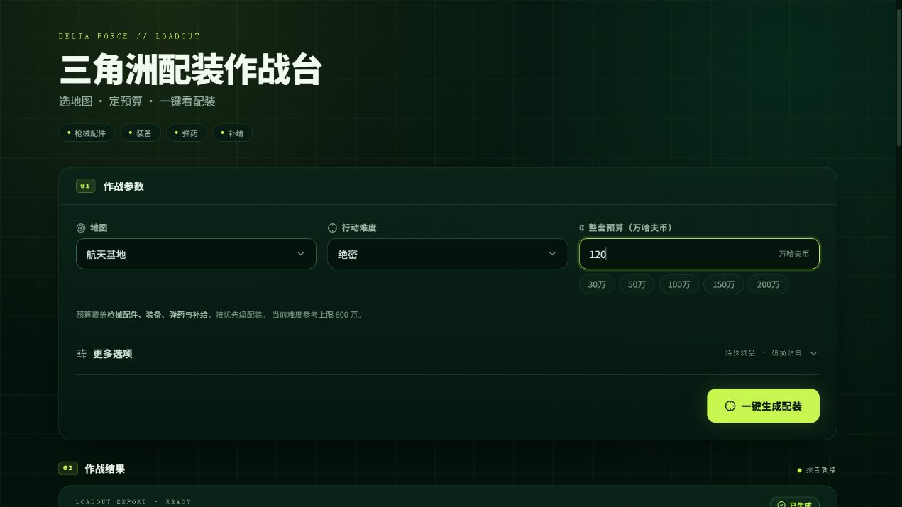
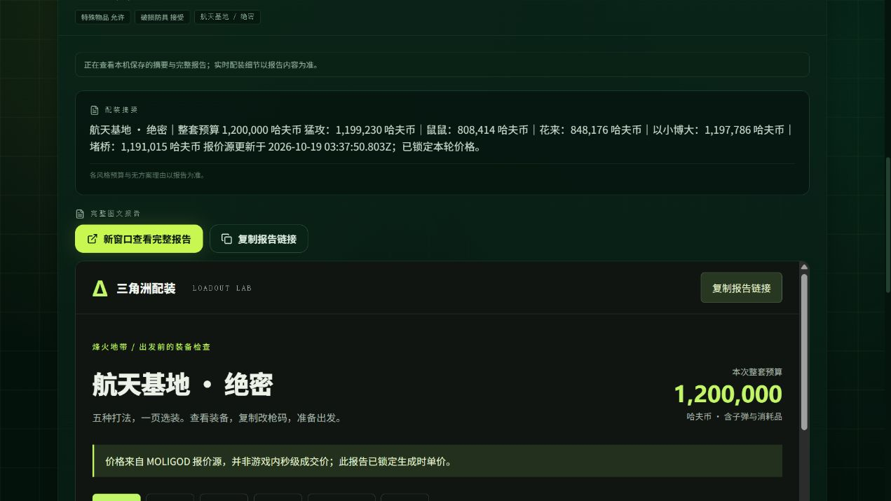

# V20 交互页面与课程演示材料

更新日期：2026-10-19。V20 是女娲交互入口与文档版本；V21 独立页面已随 v0.4.0 发布，配装核心仍为 V19。

- [搭建报告（Word，17页，无封面）](搭建报告_V20_交互版.docx)：按案例背景、准备、工作流搭建、页面设计、发布与验证组织，包含实际页面截图。
- [两分钟以内演示文案](演示视频文案_V20.txt)：约1分50秒，包含课程作业背景、分镜和口播。
- [交互页面配置与复现说明](nuwax-v20.md)：字段、资源绑定、操作流程、测试结果与平台边界。
- [女娲智能体提示词](agent_prompt_v20.txt)：引导表单并避免页面提交后重复调用工作流。

## V21 源码导出与独立运行

- [独立页面使用说明](../web/README.md)
- [源码导出检查、迁移与验证](nuwax-export-audit-v21.md)
- [女娲 V20 前端源码参考归档](nuwax-page-source-v20.zip)
- [原始导出校验值与逐文件清单](nuwax-source-manifest.json)

V20 Word报告保留课程版本，V21新增内容以迁移记录为准。

## 页面截图

表单入口：

完整报告在页面内展示：

截图中的价格是当时测试结果，不代表当前报价。课程参考手册未随仓库重新分发。
