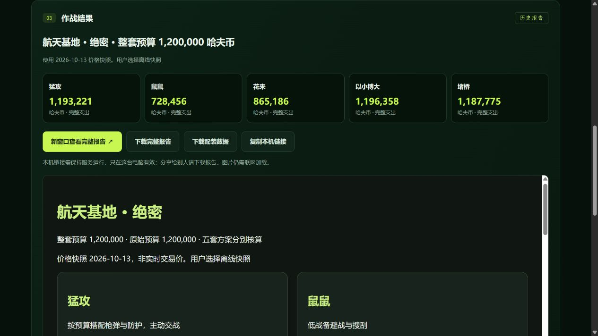

# 女娲 V20 源码导出检查与独立页面 V21

日期：2026-10-19。独立应用版本0.4.0，核心规则仍为V19，动态报价逻辑仍为V18。

## 1. 导出与保留

在女娲“三角洲配装作战台”开发器右上角菜单执行“导出项目”，取得 ZIP，共72个文件。未编辑女娲源码、未导入覆盖、未重新发布或更改资源绑定。

原始导出包保留在维护者本地；SHA-256 为 `b19c87b8b9336e85a8a2bed9ad787ab949663a2ac5793a5e363e066d47ce6317`。

仓库中的 [前端源码参考包](nuwax-page-source-v20.zip) 只收录原始 `src/` 和前端构建配置，文件原文保留；剔除平台数据源绑定配置、平台技能、项目内部说明和环境设置。归档不是女娲完整导入包，不能代替原始备份。逐文件校验值见 [manifest](nuwax-source-manifest.json)。常见密钥格式扫描未发现命中，不等同于完备的安全审计。

## 2. 检查发现

| 项目 | 女娲导出源码 | 独立版处理 |
| --- | --- | --- |
| 技术结构 | React、TypeScript、Vite、Tailwind，模板含较多未使用组件 | 根据实际表单和报告交互重写为无外部依赖的HTML/CSS/JS |
| 生成入口 | 平台 `/api/page/w/…`，`credentials: same-origin` | 本机 `/api/generate` 调用仓库现有引擎 |
| 数据来源 | `cpage_config.json` 记录工作流资源绑定；ZIP无完整物品数据表 | 复用 `.agents/skills/delta-loadout/data/` |
| 报告 | 白名单限定外部报告站，完整URL中携带报告参数 | 本机生成并持久化HTML、JSON与元数据，短UUID路径访问 |
| 开发插件 | 平台设计模式插件及 `/sdk/dev-monitor.js` 注入 | 独立运行不加载平台插件或监控SDK |
| 历史 | 原女娲域名下的localStorage | 独立命名空间，最近5份索引；完整报告存磁盘 |
| 参数与规则 | 页面收参，工作流模型选装后复核 | 同一V19核心引擎校验，使用规则候选，具体配装可不同 |

导出包没有锁定依赖的 lockfile；原归档仅作可追溯源码参考，本次未安装或运行其原始模板依赖。独立版使用Node.js内置模块，无需安装 npm 依赖。

## 3. 独立运行

在完整仓库根目录运行 `npm start`，打开 **http://127.0.0.1:8787**。使用说明见 [web/README](../web/README.md)。该实现面向本机使用，不是纯静态 GitHub Pages 站点，也未开放公网服务。

## 4. 自动验证

全部19项测试通过，包括原引擎预算、弹药、医疗与价格测试，以及新增本地接口、请求校验、来源限制、忙碌状态、失败恢复、报告保存与下载检查。

新增三组真实引擎测试使用2026-10-13离线快照（金额为哈夫币）：

| 场景 | 猛攻 | 鼠鼠 | 花来 | 以小博大 | 堵桥 |
| --- | ---: | ---: | ---: | ---: | --- |
| 长弓溪谷常规50万 | 497755 | 219225 | 371177 | 388315 | 不适用 |
| 航天基地绝密100万 | 无方案，提示预算缺口 | 728456 | 841325 | 990536 | 无方案 |
| 航天基地绝密120万 | 1193221 | 728456 | 865186 | 1196358 | 1187775 |

所有可行方案均满足总预算与入场门槛；绝密猛攻可行时弹药至少五级，预算不足不降低此要求；鼠鼠可输出且至少四级。报告保留完整配件、补给及HTTPS图片链接。此表是本地规则候选结果，与女娲V20实测的报价时点和选装方式不同。

## 5. 浏览器验证

实际浏览器操作已通过：长弓溪谷常规50万获取到最新有效报价并生成报告；航天基地绝密120万切换离线快照，五板块均完整展示；HTML下载成功且文件内容与本机报告一致；复制链接与实际报告路径一致；刷新后最近记录保留，点击恢复的报告路径与原值一致。自动测试还验证了新服务实例可以读取先前保存的报告。

最新报价来自2026-10-19 13:32:34（北京时间），当次长弓常规50万的猛攻472025、鼠鼠217273、花来365711、以小博大390525，堵桥不适用。后续行情可能变化。

